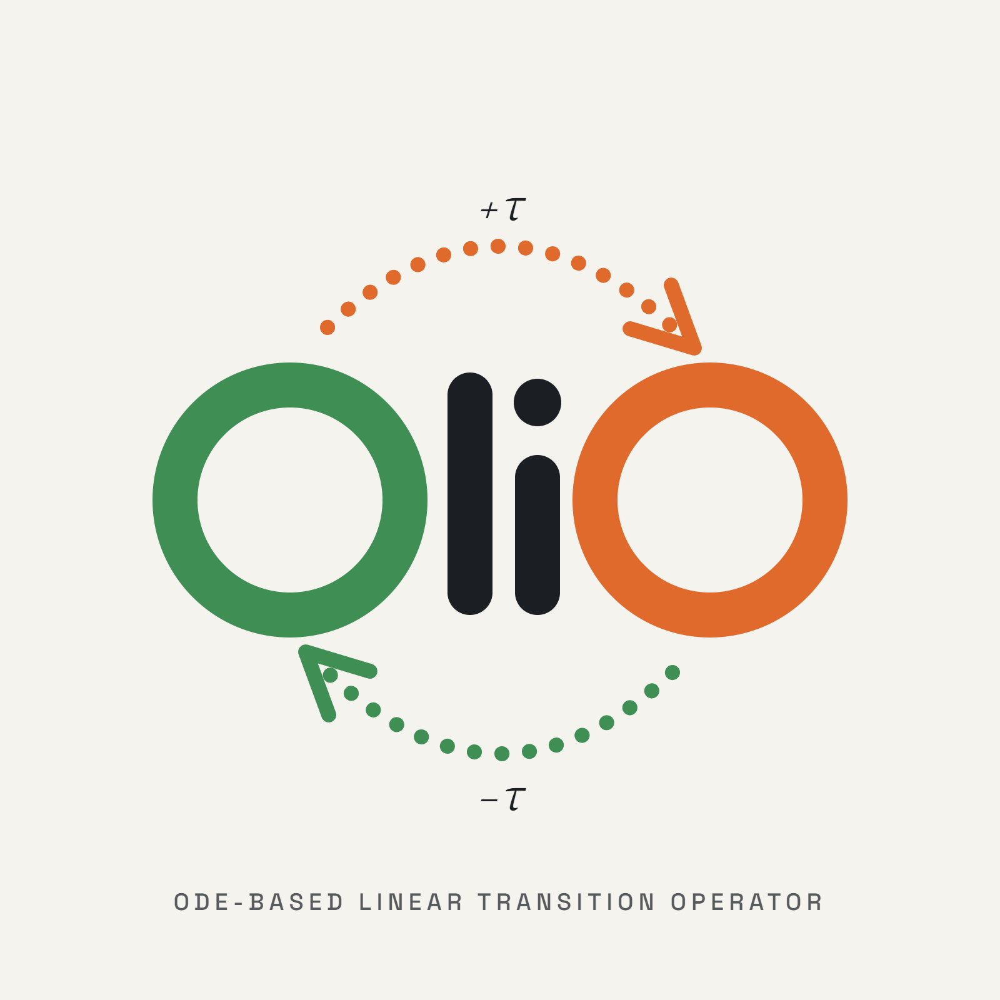

# [NeurIPS 2026] OliO: ODE-based Linear Transition Operator for Self-Supervised Time Series Forecasting
<a href="https://github.com/eai-lab/AliO"></a>
<a href="https://github.com/eai-lab/AliO"></a>
<a href="https://neurips.cc/virtual/2026/loc/sydney/poster/150464"></a>

* Paper <a href="https://arxiv.org/abs/2610.23345"> NeurIPS 2026 [arxiv] </a>

* Poster <a href="https://neurips.cc/media/PosterPDFs/NeurIPS%202026/150464.png?t=1791857063.7298853">link</a>



# Abstract
Self-supervised representation learning has  advanced time series forecasting by capturing robust features from unlabeled data. However, existing contrastive and masking-based methods often struggle to explicitly model the underlying temporal flow, either by treating time lag as noise or by disrupting the inherent temporal dynamics essential for forecasting. To address these limitations, we propose OliO (**O**DE-based **Li**near Transition **O**perator), a plug-and-play self-supervised learning method that learns bidirectional temporal flows as a continuous and structurally consistent dynamical system. OliO introduces a transition operator derived from linear Ordinary Differential Equations (ODEs) to align latent representations across arbitrary time shifts. By imposing a strictly upper triangular constraint on the transition matrix, we mathematically ensure numerical stability and enforce a robust polynomial boundary that effectively captures long-term dependencies while preventing the exponential divergence typically found in unconstrained ODE-based models. This structural constraint induces a temporally coherent representation space that preserves the underlying flow essential for accurate forecasting. Extensive experiments across various backbone architectures and benchmarks demonstrate that OliO achieves significant performance gains, providing Mean Squared Error (MSE) reductions of up to 5.75% over the most competitive grid-searched SOTA baselines. The code is available at *https://github.com/eai-lab/OliO*

# Method Overview

Given two overlapping historical windows $x^{(t)}$ and $x^{(t+\tau)}$ separated by a signed lag $\tau$, a shared backbone $f_\theta$ and a projection head $g_\phi$ encode them into pseudo-outputs $h^{(t)}$ and $h^{(t+\tau)}$. OliO then **transitions** one representation to the other's time point before aligning them.

**1. ODE-based transition operator.** From the linear ODE $\frac{dh}{d\tau} = Kh$ with a learnable generator $K$ and a shared learnable offset $v$:

$$
\hat{h}^{(t+\tau)} = e^{\tau K} h^{(t)} + \tau v, \qquad
\hat{h}^{(t)} = e^{-\tau K} h^{(t+\tau)} - \tau v
$$

**2. Strictly upper-triangular generator.** $K$ is constrained to be strictly upper triangular, so it is nilpotent ($K^q = 0$, $q \le d_h$). The matrix exponential is then an *exact finite polynomial* in the lag, with no exponential divergence in either temporal direction:

$$
e^{\pm \tau K} = \sum_{j=0}^{q-1} \frac{(\pm\tau)^j K^j}{j!}
$$

**3. Bidirectional alignment objective.** Each transitioned representation is aligned with the independently encoded target (stop-gradient), in both directions:

$$
\mathcal{L}_{\text{OliO}} = \frac{1}{2}\Big[\big(1 - \cos(\mathrm{sg}(h^{(t+\tau)}), \hat{h}^{(t+\tau)})\big) + \big(1 - \cos(\mathrm{sg}(h^{(t)}), \hat{h}^{(t)})\big)\Big]
$$

**Plug-and-play.** OliO operates on the final-layer representation of any forecasting backbone. The projection head and transition module are used **only during pre-training** and are discarded afterward, so downstream forecasting keeps the original backbone's architecture and inference cost.

# Main Results

### Full fine-tuning & frozen-backbone linear probing
Average MSE (lower is better) against TimesURL, the strongest SSL baseline by aggregate MSE. Mean ± average three-seed sample standard deviation over 6 datasets × 4 horizons.

| Backbone | TimesURL (FT) | **OliO (FT)** | TimesURL (Linear probe) | **OliO (Linear probe)** |
|---|---|---|---|---|
| PatchTST | 0.2925 ± 0.0007 | **0.2898 ± 0.0007** | **0.2994 ± 0.0011** | 0.2997 ± 0.0008 |
| iTransformer | 0.3300 ± 0.0017 | **0.3262 ± 0.0022** | 0.3412 ± 0.0007 | **0.3369 ± 0.0007** |
| TimeVLM | 0.2918 ± 0.0018 | **0.2906 ± 0.0014** | – | – |

- OliO outperforms TimesURL in **58 / 72** backbone–dataset–horizon settings (up to **5.75%** lower MSE).
- Averaged per dataset–backbone group, OliO wins **17 / 18** groups (two-sided exact Wilcoxon signed-rank test, $p = 3.81 \times 10^{-5}$).

### Zero-shot forecasting with LightGTS-4M
A single pretrained checkpoint evaluated on 8 unseen datasets (MSE, averaged over 4 horizons).

| Dataset | TimesURL | Mask Recon. (default) | **OliO** |
|---|---|---|---|
| ETTh1 | 0.4096 | 0.3958 | **0.3937** |
| ETTh2 | 0.3501 | 0.3474 | **0.3420** |
| ETTm1 | 0.3461 | 0.3335 | **0.3329** |
| ETTm2 | 0.2566 | **0.2461** | **0.2461** |
| Weather | 0.2357 | **0.2134** | 0.2182 |
| ECL | 0.2556 | 0.2476 | **0.2325** |
| Solar | 0.1679 | 0.1712 | **0.1612** |
| Traffic | 0.5540 | 0.5364 | **0.5010** |
| **Average** | 0.3219 | 0.3114 | **0.3034** |

# Supported Backbones & Datasets

- **Backbones:** [PatchTST](https://github.com/yuqinie98/patchtst), [iTransformer](https://github.com/thuml/iTransformer), [TimeVLM](https://github.com/CityMind-Lab/ICML25-TimeVLM), and [LightGTS](https://arxiv.org/abs/2506.06005) (zero-shot)
- **Datasets:** ETTh1, ETTh2, ETTm1, ETTm2, Weather, Electricity (ECL), with prediction horizons {96, 192, 336, 720}

The benchmark datasets can be obtained from the [Autoformer](https://github.com/thuml/Autoformer) repository.

### How to use
```bash
pip install -r requirements.txt
```

#### Pretrain
```bash
bash scripts/<pretrain>/<model>/<dataset>.sh
```

#### Finetune
```bash
bash scripts/<finetune>/<model>/<dataset>.sh
```

# Citation
If you find this work useful, please cite our paper:

```bibtex
@inproceedings{park2026olio,
  title     = {OliO: ODE-based Linear Transition Operator for Self-Supervised Time Series Forecasting},
  author    = {Kwangryeol Park, Seulki Lee},
  booktitle = {Advances in Neural Information Processing Systems},
  year      = {2026}
}
```

# Acknowledgement
We appreciate the following repositories for their valuable code and datasets:
- [Autoformer](https://github.com/thuml/Autoformer)
- [Time-Series-Library](https://github.com/thuml/Time-Series-Library)
- [PatchTST](https://github.com/yuqinie98/patchtst)
- [iTransformer](https://github.com/thuml/iTransformer)
- [Time-VLM](https://github.com/CityMind-Lab/ICML25-TimeVLM)
- [TimeSiam](https://github.com/thuml/TimeSiam)
- [AliO](https://github.com/eai-lab/AliO)

This work was supported by the Technology Innovation Program (RS-2026-25618509 and RS-2026-25620133) funded by the Ministry of Trade, Industry and Energy (MOTIE, Republic of Korea) and the Institute of Information & Communications Technology Planning & Evaluation (IITP) grant funded by the Korea government (MSIT) (RS-2026-25617720, AI Star Fellowship Support Program).

# Contact
If you have any questions, please contact Kwangryeol Park (pkr7098@unist.ac.kr) or open an issue.
